 

**Convierto procesos manuales —Excel, WhatsApp, papeles— en sistemas empresariales que se controlan, se integran y escalan.**
Diseño, construyo y despliego el producto completo: backend, frontend, móvil, datos e IA.

 

&nbsp;&nbsp;&nbsp;&nbsp;

---

### 🧩 En qué ayudo

- **Sistemas de gestión, POS y ERP** a medida — inventario, caja, ventas y reportes en un solo lugar.
- **E-commerce y catálogos industriales** — multimoneda, multilenguaje y listos para producción.
- **Automatización e IA aplicada** — asistentes, análisis de datos y procesos que dejan de depender de planillas.
- **Apps móviles (iOS/Android) y sitios web** — de principio a fin: diseño, desarrollo y despliegue.

### 🛠️ Stack

### 📊 En números

- **61 proyectos** documentados con arquitectura, flujos y decisiones técnicas.
- **251 diagramas** de arquitectura, flujos de trabajo, estados y modelos de datos.
- Sistemas en **producción** para negocios reales en Bolivia 🇧🇴.

 

**¿Tu empresa necesita ordenar su operación?**

[**→ Ver el portafolio completo**](https://github.com/santiagoAbasto/portfolio-santiago-abasto)

